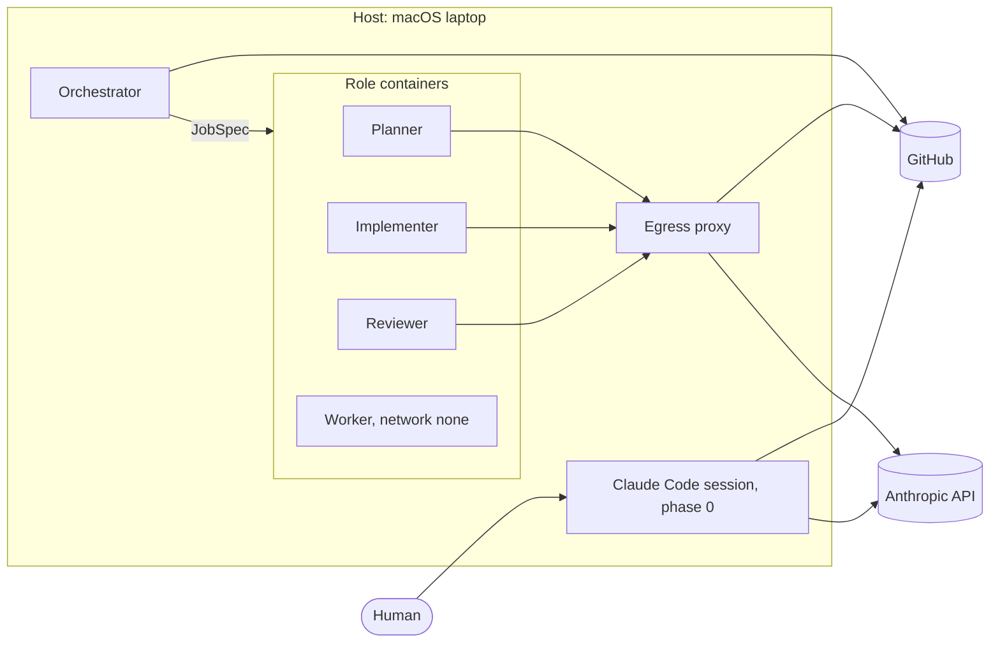

# Threat model

Version 0, written in phase 0. Every phase updates this document and checks its
mitigations against it; `tests/test_threat_model.py` guards its structure.

## Scope and assumptions

This version describes the repository as phase 0 builds it, and the architecture in
`docs/spec.md` as planned. Rows for later phases are proposals until the phase that
builds them.

Assumptions:
- One human owns the repository, the laptop and every credential, and merges every PR.
- The laptop, macOS and Docker Desktop are not compromised when work starts.
- GitHub and Anthropic are trusted as services.
- The repository is public, because GitHub Free has rulesets only for public
  repositories (`docs/spec.md`, Environment).

Out of scope: physical access to the laptop, a compromise of GitHub or Anthropic
themselves, and what v1 leaves out: Kubernetes, GPUs, multiple users and cloud hosting.

## Assets

- The Claude OAuth token (`CLAUDE_CODE_OAUTH_TOKEN`): it spends the subscription and
  acts as the human toward Anthropic.
- GitHub credentials: the human's `gh` login and, from phase 4, the agent identities.
  They can push, comment, open PRs and change repository settings.
- The host: the laptop with Docker Desktop, the Keychain and the human's files.
- The integrity of `main`: everything that runs, the guardrails included, comes from it.
- Evaluation code (`eval/` and the CI config): it decides whether an experiment counts.
- Competition data: licensed data that must not leave the laptop or enter git.
- Budget: tokens and compute. Only the human raises it.

## Actors and entry points

- Prompt injection: text that an LLM reads and that tries to steer it, in issues,
  comments, competition data or dependencies.
- A compromised action or package: a GitHub Action or Python package that runs code
  in CI or on the host.
- An over-eager or rogue agent: it weakens a guardrail, merges its own work or reaches
  beyond its task.
- Container escape: code in a role container that reaches the host.
- A leaked token, used from elsewhere.
- Exposure through the public repository: a secret, employer data or competition data
  that is committed.

## Trust boundaries

- **Host**: the macOS laptop. In phase 0, Claude Code runs here in the human's
  session, limited by the permission rules in `.claude/settings.json`.
- **Orchestrator**: a deterministic state machine without an LLM that runs natively
  on the host (phase 1). It starts every container through a JobSpec.
- **Role containers**: planner, implementer, reviewer and worker run as ephemeral,
  hardened containers (phase 2). The worker has no network and no secrets.
- **Egress proxy**: LLM roles reach the outside only through an allowlist proxy that
  passes the Anthropic API and GitHub (phase 2).
- **GitHub**: the source of truth for work and outcomes. Rulesets, CI and CODEOWNERS
  live here.
- **Anthropic API**: LLM roles send their prompts here, with the OAuth token.

## Threats

Each row is one threat. The columns:
- `ID`: `T-NNN` with three digits, unique.
- `Threat`: what goes wrong.
- `Boundary`: one of the six boundaries above. A row has one boundary: a threat that
  crosses two boundaries gets two rows.
- `Mitigation`: what stops the threat, or will stop it.
- `Phase`: the phase from the roadmap in `docs/spec.md` in which the mitigation is
  complete. For `partial`, that is the phase that finishes it.
- `Status`: `done` when the mitigation exists and covers the threat, `partial` when
  part of it exists, `planned` when nothing implements it yet.

The honesty rule: a `done` or `partial` mitigation names the existing mechanism that
implements it, as a path in backticks that is not a `.md` file or as an issue or PR
number. A `.md` file does not count as a mechanism: a document describes a rule but
does not enforce it. A `planned` mitigation may name a path that does not exist yet.
The test checks that the names are there and that the paths exist; the reviewer
checks that the mechanism really mitigates the threat.

Status values: `done`, `partial`, `planned`.

| ID | Threat | Boundary | Mitigation | Phase | Status |
|----|--------|----------|------------|-------|--------|
| T-001 | A direct push, a force push or a deletion changes `main` without a PR and CI. | GitHub | The ruleset `protect-main` from `scripts/set-rulesets.sh` (#6) is active on `main` with the rules `deletion`, `non_fast_forward`, `pull_request` and `required_status_checks`. A direct push to `main` of agent-factory was rejected (GH013); the rejection of a force push was tested on a throwaway repository with the same ruleset, not on agent-factory itself. The evidence is recorded in #16. | 0 | done |
| T-002 | A secret is committed to the public repository. | GitHub | The `secret-scan` job runs gitleaks over the full history with `--ignore-gitleaks-allow` (`.github/workflows/ci.yml`, `tests/test_secret_scan.py`, #4). Files that reconfigure or silence gitleaks are protected paths (#8). Proposal, not built yet: a pre-commit hook (#9). | 0 | partial |
| T-003 | A moved action tag runs foreign code in CI. | GitHub | Every `uses:` is pinned to a full commit SHA (`tests/test_workflow_policy.py`, #5). Each SHA is verified with `git ls-remote` before it is pinned (review rule). | 0 | done |
| T-004 | A workflow writes to the repository or leaks its token. | GitHub | Top-level `permissions` is read-only, a job-level write needs a `WRITE_ALLOWLIST` entry, there is no `pull_request_target` trigger, every checkout sets `persist-credentials: false` and no `run:` script holds a `${{ }}` expression (`tests/test_workflow_policy.py`, #5). In addition, the human set two repository Actions settings by hand: a read-only `GITHUB_TOKEN`, and actions must be pinned to a full commit SHA. | 0 | done |
| T-005 | A PR skips a required check through a paths filter on a trigger. | GitHub | No trigger has a `paths` or `paths-ignore` filter (`tests/test_workflow_triggers.py`, #3). | 0 | done |
| T-006 | A tampered gitleaks, actionlint or shellcheck tarball runs in CI. | GitHub | Each tarball is downloaded over https only and checked against a pinned sha256 before it is unpacked (`.github/workflows/ci.yml`, `tests/test_workflow_lint.py`, `tests/test_secret_scan.py`, #4, #5). This proves integrity, not authenticity. Proposal, phase 10: check a signature or provenance. | 10 | partial |
| T-007 | A malicious or compromised Python dependency runs on the host. | host | `uv.lock` is a protected path (#8), CI installs with `uv sync --locked`, and a new release must be at least 14 days old (review rule, #26). Proposal, phase 10: a vulnerability and provenance check. | 10 | partial |
| T-008 | An agent weakens a guardrail by changing a protected file. | host | Covered: the `Edit` ask rule for every protected path (`.claude/settings.json`, `tests/test_claude_settings.py`, #7). Not covered: writes through Bash (#28, see T-009), and `.github/CODEOWNERS` (#8) does not block a merge until phase 4. | 4 | partial |
| T-009 | An agent writes a protected file through Bash, such as with a redirect, without a prompt. | host | Guard Bash writes to protected paths (#28). | 0 | planned |
| T-010 | An agent loosens ruff, pyright, pytest or uv through an override file or `pyproject.toml`. | host | Protect `pyproject.toml` and `tests/test_tooling.py` (#30), and fail when an override file such as `ruff.toml` or `pyrightconfig.json` appears (#31). | 0 | planned |
| T-011 | A session runs with permission prompts skipped, in `auto`, `acceptEdits` or `bypassPermissions`. | host | Only `bypassPermissions` is enforced, and only as `defaultMode` in `.claude/settings.json` (`tests/test_claude_settings.py`, #7). No rule stops `acceptEdits` or `auto`: AGENTS.md requires `default` or `plan` (#26), but nothing enforces the flag. Proposal, phase 5: containers start Claude Code with fixed flags. | 5 | partial |
| T-012 | An agent applies or loosens the ruleset itself. | GitHub | The deny rules `Bash(gh api *rulesets*)` and `Bash(*set-rulesets.sh*--apply*)` (`.claude/settings.json`, #7) and the `CLAUDECODE` guard in `scripts/set-rulesets.sh` (#6) are tripwires, not a boundary. Phase 4: agent identities without admin rights. | 4 | partial |
| T-013 | An agent merges its own PR. | GitHub | The deny rule `Bash(gh pr merge *)` (`.claude/settings.json`, #7). The ruleset requires 0 approvals in phase 0 (`scripts/set-rulesets.sh`); phase 4 brings separate identities and 1 required approval. | 4 | partial |
| T-014 | An agent reads a secret on the host: an env file, an SSH or AWS key, or the gh token. | host | The deny rules `Read(./.env*)`, `Read(~/.ssh/**)`, `Read(~/.aws/**)` and `Bash(gh auth token*)` (`.claude/settings.json`, `tests/test_claude_settings.py`, #7). Read denies do not cover `cat` through Bash; no rule covers reading a secret through Bash yet. From phase 2, a role container holds only its own credentials. | 2 | partial |
| T-015 | An agent sends data from the host to an arbitrary destination. | host | The deny rules `Bash(curl *)` and `Bash(wget *)` (`.claude/settings.json`, #7). `python -c`, `git push` and `gh api` can send data too; `git push` and `gh api` are ask rules. From phase 2, role containers reach the outside only through the egress proxy (T-020). | 2 | partial |
| T-016 | Code in a role container escapes to the host. | role containers | The only way to start a container is a JobSpec passed to `run_container()`. Non-root, read-only rootfs, cap_drop ALL, no-new-privileges, memory, CPU and pids limits, timeouts, and no `docker.sock` mount. | 2 | planned |
| T-017 | A role gets more network, mounts or credentials than its task needs. | role containers | A role matrix, enforced through the JobSpec, fixes the network profile, mounts and credentials per role. | 1 | planned |
| T-018 | Prompt injection through issue or comment text steers an LLM role. | GitHub | Decide the visibility of the per-competition repositories, whose issues and comments agents read. A hijacked role can do only what the role matrix allows (T-017). | 4 | planned |
| T-019 | Prompt injection through competition data steers a role. | role containers | Only the worker reads competition data, with network none and no secrets (ADR-003, #13). | 2 | planned |
| T-020 | An LLM role sends the OAuth token or data to an arbitrary destination. | egress proxy | An internal network and an allowlist proxy that passes only the Anthropic API and GitHub. | 2 | planned |
| T-021 | An LLM role leaks data through GitHub itself, such as in a gist or a comment. | GitHub | A separate GitHub identity per role, with the smallest scopes the role needs. | 4 | planned |
| T-022 | The Claude OAuth token leaks and is used elsewhere. | Anthropic API | The token goes only into the env of LLM roles in a container, and `ANTHROPIC_API_KEY` stays unset (ADR-004, #13). | 5 | planned |
| T-023 | Runaway token or compute spend. | Anthropic API | A budget that stops new runs when it is spent; only the human raises it. | 9 | planned |
| T-024 | LLM output steers the control flow of the orchestrator. | orchestrator | The orchestrator is a deterministic state machine without an LLM (ADR-002, #12); LLM output is data, never a transition. | 1 | planned |
| T-025 | An agent changes evaluation code to inflate its score. | GitHub | Code-owner review for `eval/` from phase 4. Preparation, not enforced: `.github/CODEOWNERS` already owns `/eval/` (#8). | 4 | planned |
| T-026 | Competition data is committed to git. | GitHub | The competition template keeps data out of git; gitleaks does not catch data files. | 4 | planned |
| T-027 | An unpinned or tampered base image runs as a role container. | role containers | Images are pinned by digest, and `images/**/Dockerfile` is a protected path. | 2 | planned |
| T-028 | The Claude OAuth token leaks on the host, such as when a check prints it. | host | `scripts/doctor.py` checks the Keychain item without showing its value (#15). | 0 | planned |
| T-029 | A secret is written into a PR body or an issue comment. | GitHub | Proposal, phase 4: the orchestrator scans the text with gitleaks before it posts it. Today this is only a habit. | 4 | planned |

## Residual risks

- No independent reviewer in phase 0: 0 required approvals, and the human is the only account, until separate identities arrive in phase 4 (milestone decision; `scripts/set-rulesets.sh`).
- In `acceptEdits` mode a Bash redirect into `AGENTS.md` ran without a prompt (PR #27, trial 4). The guard for Bash writes is #28.
- The `Edit(...)` ask rules in `.claude/settings.json` cover only the Edit tool, not Bash or other tools that write files (PR #27; AGENTS.md, Permission mode; #28).
- Override files for the tool config, such as `ruff.toml`, `pyrightconfig.json`, `pytest.ini`, `uv.toml` or a nested `pyproject.toml`, can replace the ruff, pyright, pytest or uv config without touching a protected path; `pyproject.toml` and `tests/test_tooling.py` are not protected yet (#30, #31).
- The pin is a lower bound: `PINNED_PATHS` in `tests/test_codeowners.py` fails only when AGENTS.md drops a pinned path. A path that AGENTS.md adds is not pinned until an issue adds it to the pin, so until then it can be dropped again without a failing test (#8).
- Integrity, not authenticity: CI checks the gitleaks, actionlint and shellcheck tarballs against a pinned sha256. The hash comes from the same GitHub release (its checksums file or the asset digest), so it proves that the download is the file that was pinned, not that the release is genuine; no signature or provenance is checked (#4, #5; `.github/workflows/ci.yml`).
- A committed secret is on GitHub before CI sees it: gitleaks runs in CI on the pushed branch, and the repo is public. The pre-commit hook from #9 runs only where someone installed it (#4, #9).
- `.github/CODEOWNERS` does not block a merge until phase 4: `scripts/set-rulesets.sh` sets `require_code_owner_review` to false (#8).
- Auto mode is the default: without `--permission-mode`, a terminal session starts in `auto` in Claude Code 2.1.303. AGENTS.md requires `default` or `plan`, but nothing enforces the flag (#26; AGENTS.md, Permission mode).
